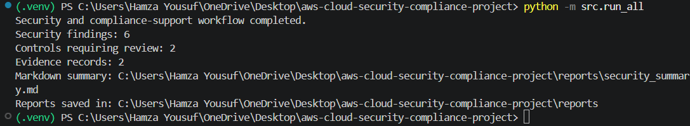

# AWS Cloud Security & Compliance Automation

A Python-based portfolio project that analyzes simulated AWS security data, identifies potential risks, maps findings to preliminary SOC 2 control references, and tracks supporting evidence and remediation status.

## Project Overview

This project demonstrates practical skills in Python, cloud security analysis, security reporting, compliance-support workflows, input validation, and automated testing.

The workflow runs locally using simulated JSON data. It does not connect to an AWS account or deploy cloud resources.

## Features

- **IAM Policy Analysis:** Detects selected risky IAM policy patterns, including wildcard actions, unrestricted resource scope, and potentially risky `NotAction` statements.
- **CloudTrail Event Analysis:** Identifies selected security-relevant events, including stopped logging, access key creation, failed console logins, and security group ingress changes.
- **Cloud Configuration Analysis:** Flags simulated storage buckets with public access or disabled encryption, and security group rules exposing selected sensitive ports to `0.0.0.0/0`.
- **Combined Security Reporting:** Combines IAM, CloudTrail, and cloud configuration findings into a JSON report with severity levels and remediation guidance.
- **Markdown Security Summary:** Generates a readable report with finding totals, severity counts, and finding details.
- **SOC 2 Control Mapping:** Maps selected findings to preliminary SOC 2 control references for review.
- **Evidence Tracking:** Validates evidence records and tracks collection dates, review statuses, reviewer notes, remediation owners, due dates, and remediation status.
- **Assessment Reporting:** Combines control mappings and related evidence into an assessment report for review.
- **Input Validation:** Checks for malformed or unexpected input structures, invalid dates, duplicate evidence IDs, and invalid status values.
- **Automated Testing:** Uses pytest to test detection rules, input validation, evidence tracking, and report generation.
- **Continuous Integration:** Uses GitHub Actions to run automated tests on pushes and pull requests.

## Technologies

- Python
- pytest
- JSON
- Git and GitHub
- GitHub Actions

## Project Structure

```text
aws-cloud-security-compliance-project/
|-- .github/
|   |-- workflows/
|   |   |-- tests.yml
|-- docs/
|   |-- architecture.md
|   |-- images/
|       |-- security-analysis.png
|-- reports/
|   |-- security_report.json
|   |-- security_summary.md
|   |-- soc2_assessment_report.json
|   |-- soc2_evidence_report.json
|   |-- soc2_mapping_report.json
|-- sample_data/
|   |-- cloud_config.json
|   |-- cloudtrail_events.json
|   |-- iam_policy_restricted.json
|   |-- iam_policy_wildcard.json
|   |-- soc2_controls.json
|   |-- soc2_evidence.json
|-- src/
|   |-- cloud_config_analyzer.py
|   |-- cloudtrail_analyzer.py
|   |-- iam_analyzer.py
|   |-- report_generator.py
|   |-- run_all.py
|   |-- soc2_assessment.py
|   |-- soc2_evidence_tracker.py
|   |-- soc2_mapper.py
|-- tests/
|-- .gitignore
|-- README.md
|-- requirements.txt
```

## Getting Started

### 1. Clone the repository

```powershell
git clone https://github.com/hamzay02/aws-cloud-security-compliance-project.git
cd aws-cloud-security-compliance-project
```

### 2. Create and activate a virtual environment

```powershell
python -m venv .venv
.\.venv\Scripts\Activate.ps1
```

### 3. Install dependencies

```powershell
python -m pip install -r requirements.txt
```

### 4. Run the workflow

```powershell
python -m src.run_all
```

The workflow analyzes the sample data and generates reports in the `reports/` directory, including the combined JSON security report and Markdown summary.

### 5. Run the tests

```powershell
python -m pytest -v
```

The project has a local test suite covering detection rules, input validation, evidence tracking, and report generation. GitHub Actions is configured to run the test suite on pushes and pull requests.

## Example Run

The screenshot below shows the local security and compliance-support workflow completing successfully.



## Sample Results

The included simulated dataset is expected to produce the following results:

- **6 security findings**
- **5 High-severity findings**
- **1 Medium-severity finding**
- **2 SOC 2 controls requiring review**
- **2 evidence records**

These results describe the included sample data only and do not represent findings from a live AWS environment. Run the workflow to regenerate the reports and confirm the current results.

## Detection Scope and Limitations

- Detection rules cover selected patterns and do not replace comprehensive IAM policy evaluation or a full security assessment.
- CloudTrail events, IAM policies, and cloud configuration records are simulated; the project does not collect live AWS telemetry.
- Cloud configuration checks cover selected storage settings and selected sensitive ports exposed to the IPv4 CIDR `0.0.0.0/0`. They do not provide comprehensive network analysis or IPv6 exposure detection.
- SOC 2 control mappings are preliminary examples and should be validated against applicable criteria and an organization's control design.
- Evidence tracking supports documentation and review workflows but does not establish control effectiveness or compliance.
- Generated reports do not constitute a formal security audit or SOC 2 attestation.

## Future Improvements

- Expand cloud security detection rules and configuration checks.
- Add support for additional remediation workflows.
- Improve security reporting and evidence review capabilities.

## Disclaimer

This is an educational portfolio project that uses simulated data. It is not an official compliance tool, does not constitute a formal security audit, and does not provide a SOC 2 attestation.
